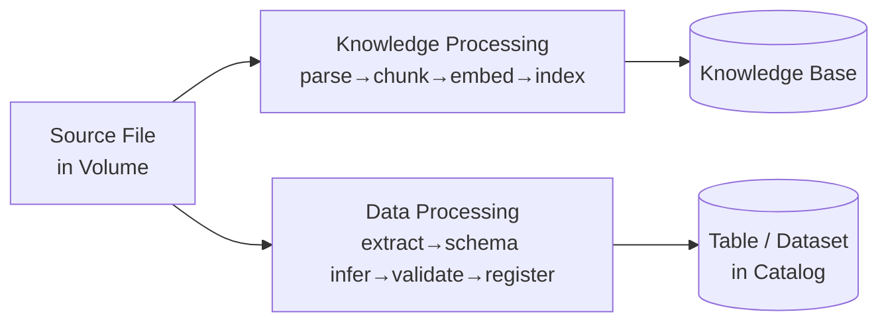

# Resource, Catalog and Artifact Model

状态：DECIDED（模型）/ 表实现为 PROPOSED（P0/P1）。日期：2026-11-22。

## 三个注册表的职责切分（防重叠）

| 注册表 | 回答的问题 | 存什么 | 不存什么 |
|---|---|---|---|
| Resource Registry | "存在什么、谁的、什么状态" | 全资源身份（id/workspace_id/owner/type/status/uri 引用） | 内容字节、领域元数据细节 |
| Data Catalog | "数据资产在哪、长什么样、能不能用" | 表/卷/KB 的元数据（schema、采样统计、SLayer 链接、使用热度） | 物理数据集（零拷贝，只引用） |
| Artifact Registry | "谁产出的、哪次运行、能否复现" | 产物元数据（类型/版本/状态/存储 URI/血缘：run_id+inputs+code 版本） | 产物字节（在对象存储/数仓/KB 里） |

同一物化数据集可同时是 Catalog 表（可发现）与 Artifact（有血缘），以**引用双挂**实现，
禁止拷贝两份。

## 统一资源模型（4.2/4.4）

`User → Workspace → Resources`，Resources 含：Data Sources、Catalogs、
Schemas、Tables、Volumes、Knowledge Bases、Agents、Notebooks、Pipelines、
Dashboards、Dives、Computes、Schedules。

- Data Source：到外部/内部系统的连接定义（含类型、endpoint、凭证引用、只读/读写）。
- Catalog：元数据组织与发现层（跨 Schema/Table/Volume/KB 的统一浏览、搜索、收藏）。
- Schema/Table：结构化资产（外部表只注册元数据；采样统计供选型）。
- Volume：文件与对象存储资源（复用现有 8 存储后端）；**文件可仅存放不入知识库**。
- Knowledge Base：加工索引后的知识资源（复用现有 KB 体系，原样）。
- Artifact：Agent/Notebook/Pipeline 产出（Query Result、Notebook、Pipeline Output、
  Knowledge Asset、Chart、Dashboard、Dive、Report），元数据模型见下。

## Artifact 元数据模型（4.10）

`workspace_id, created_by, created_by_agent?, execution_id, source_resource_id?,
artifact_type, schema_version, content_hash, storage_uri, version, status
(draft/validated/published/deprecated), created_at, updated_at, provenance{run_id,
inputs[], code_version, params}`。版本链不可变；状态机流转审计留痕；
大对象禁入注册表（只记 URI + hash）。

## 双通道原则（Knowledge vs Data，4.4）

同一源文件可独立参与两条处理线，**不强制统一抽象**：

- Knowledge Processing：沿用现有 ingestion 流水线（docreader + parser registry + 队列）。
- Data Processing：新 ingestion 链（见 `data-ingestion.md`）。
- 去重：源文件 hash 只存一次；两条线引用同一 blob。

Catalog 是两类资产的共同发现层；Knowledge processing 保持在 Catalog 工作流内，
不另设用户可见的加工模块（ ingested 文件可一键"注册为知识/注册为数据集"二选一或兼得）。
